# 🛡️ NEXUS : 차세대 엔터프라이즈 사내 포털 & 실시간 AI-XDR 보안 방어 체계

> 🌐 **Live Portfolio:** [https://nexus-portfolio-nu.vercel.app](https://nexus-portfolio-nu.vercel.app)  
> 📦 **GitHub Repository:** [https://github.com/stulss/nexus-portfolio](https://github.com/stulss/nexus-portfolio)  
> 📑 **PDF 다운로드:** [NEXUS_포트폴리오.pdf](https://nexus-portfolio-nu.vercel.app/NEXUS_포트폴리오.pdf)  
> 
> **작성자 / 담당 역할:** 홍주형 · 포털 아키텍트 & 보안 최고관리자 (웹·DB 하드닝, 전주기 AI 파이프라인, IAM 구축)  
> **협업 팀원:** 김태빈(보안관제 SIEM/SOAR), 이시헌(경계망 pfSense/WAF), 진혜정(시스템 인프라)  
> **기술 스택:** Python Flask, MySQL 8.4 (Docker), Flask-SocketIO, Flutter, NVIDIA NIM (Llama-3.1-Nemotron-70B), Cloudflare Security-Audit-Skill, NeMo Guardrails  
> **프로젝트 기간:** 2026.10 (2026-10-29 최신 보안 감사 및 고도화 완료)

---

## 📊 정량적 핵심 성과 (Key Metrics)

| 핵심 지표 | 실적 수치 | 상세 내용 |
|---|:---:|---|
| **자동화 테스트 검증** | **1,542+ 건** | `pytest` 수집 1,542개 테스트 전수 통과 (회귀 결함 제로화) |
| **코드베이스 규모** | **18,600+ LOC** | 포털 백엔드 7,650줄 + 테스트 8,514줄 + 공격/점검 스크립트 2,435줄 |
| **DB & 계정 권한 분리** | **43개 / 3종** | 43개 RDBMS 테이블, PoLP 기반 DB 계정 3종(`nexus_app`, `conf`, `n8n`) 분리 |
| **적대적 코드 감사 오탐률** | **0 %** | Cloudflare 6단계 적대적 서브에이전트 교차 반박을 통한 순수 결함 선별 |
| **보안 AI 엔진 (클라우드)** | **70B NIM** | 로컬 PC 부하 0%, 클라우드 `Llama-3.1-Nemotron-70B-Instruct` 연동 |
| **실시간 대응 전파 속도** | **3초 / 0.5초** | 인메모리 3초 캐시 기반 차단 전파, 0.5초 고속 복합 공격 체인 분석 |

---

## 1. 프로젝트 개요 & 분산 인프라 아키텍처

사내 AI Agent를 겨냥한 지능형 위협에 대응하기 위해, 실제 엔터프라이즈 업무 시스템(그룹웨어, ERP, HR, RAG 챗봇)을 구축하고 전방위적인 웹/DB 하드닝을 완성한 보안 특화 풀스택 프로젝트입니다.

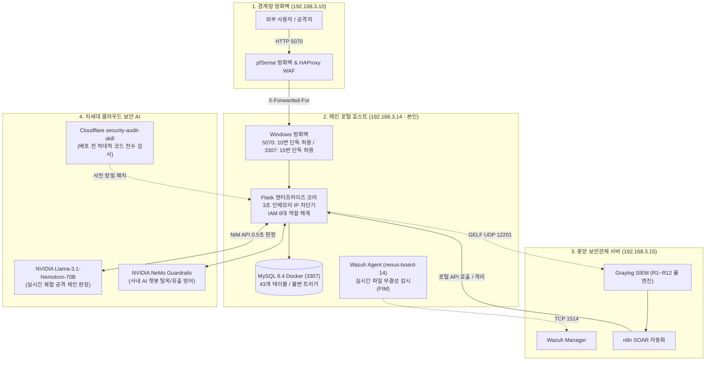

---

## 2. 차세대 3단계 전주기 보안 AI 파이프라인 (2026-10-29 고도화)

내장 그래픽 환경(외장 GPU 부재)의 한계를 극복하기 위해, **Cloudflare 적대적 감사 스킬**과 **엔비디아 클라우드 NIM 인프라(1,000 크레딧)**를 결합하여 **"로컬 부하 0%, 비용 0원, 엔터프라이즈 최고 사양"**의 방어 체계를 구축했습니다.

### ① [Phase 1: Shift-Left] Cloudflare `security-audit-skill` (6단계 적대적 코드 전수 감사)
- **오탐 제로화(0% False Positive):** 발견된 후보 취약점을 독립된 서브에이전트가 반박(Disprove)하여 살아남은 진짜 결함만 선별.
- **6단계 파이프라인:** 정찰(Recon) ➔ 공격 사냥(Coverage Hunting) ➔ 후보 검증(Validation) ➔ **독립 교차 반박(Verification)** ➔ 정형화 보고(Output) ➔ 방어 패치(Reporting).

### ② [Phase 2: In/Out Guard] NVIDIA NeMo Guardrails & Prompt Guard
- **사내 AI 어시스턴트 보호:** 사내 RAG 챗봇을 타깃으로 하는 프롬프트 인젝션(Direct/Indirect Injection) 및 시스템 프롬프트 탈옥 선제 차단.
- **기밀 유출 방지:** 응답 텍스트 내 API 토큰(`nxapi_...`) 및 기밀 문서 식별자(`NXC-...`) 마스킹.

### ③ [Phase 3: Blue Team XDR] NVIDIA Llama-3.1-Nemotron-70B-Instruct NIM
- **복합 공격 체인(Attack Chain) 추론:** 단편적인 단일 룰(예: 로그인 5회 실패)을 넘어, 연속된 다단계 침해 시도(R1 무차별 대입 ➔ 세션 탈취 ➔ R9 관리자 권한 접근 ➔ R10 기밀 결재 변조)를 종합 분석하여 0.5초 내에 악성 여부 판정 및 즉시 격리 권고.

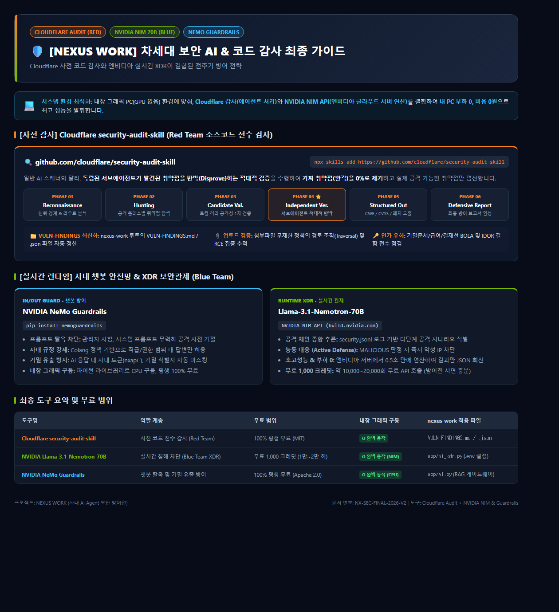

---

## 3. 2026-10-29 신규 취약점 발굴 & 실전 핫픽스

Cloudflare 정밀 감사 수행 결과 발굴된 3건의 실전 결함을 당일 즉시 핫픽스하고 회귀 테스트로 검증했습니다:

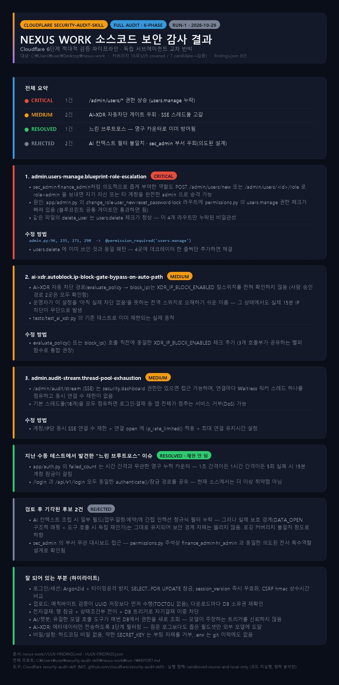

1. **[CRITICAL — 조치 완료] `/admin/users/*` 세부 인가 누락 결함 (BOLA)**
   - **원인:** `change_role`, `user_new`, `reset_password`, `lock` 라우트에 세부 권한 데코레이터가 누락되어 하위 관리자(`sec_admin`, `finance_admin`)가 최고관리자(`admin`)를 생성하거나 임의 승격할 수 있는 인가 결함 존재.
   - **조치:** `@permission_required('users.manage')` 적용 및 `test_admin.py`(29건), `test_permissions.py`(73건) 전수 통과.
2. **[MEDIUM — 조치 완료] AI-XDR 자율 차단 경로의 킬스위치(`XDR_IP_BLOCK_ENABLED`) 누락 결함**
   - **원인:** 인간 승인 경로와 달리 자율 자동 차단 경로(`evaluate_policy()`)에서 글로벌 차단 킬스위치를 건너뛰는 결함.
   - **조치:** 킬스위치가 비활성화된 경우 `ip_block_gate_closed` 사유로 차단이 차단되는 Fail-Closed 게이트 확립. `test_ai_xdr.py`(111건) 전수 통과.
3. **[MEDIUM — 조치 완료] `/admin/audit/stream` SSE 실시간 스트림 스레드 풀 고갈(Thread Exhaustion DoS)**
   - **원인:** Waitress 16개 고정 워커 스레드 환경에서 SSE 스트림을 장시간 유지할 경우 전체 포털 마비 위험.
   - **조치:** 계정당 최대 동시 스트림(`AUDIT_STREAM_MAX_CONCURRENT=3`), IP별 개설 속도 제한(`AUDIT_STREAM_OPEN_LIMIT=10/min`), 최대 수명 주기(`AUDIT_STREAM_MAX_SECONDS=600s`) 3중 안전망 구축.

---

## 4. 웹·DB 심층 하드닝 (Defense-in-Depth)

- **SQL Injection 0%:** 모든 SQL은 상수 문자열 + 파라미터 바인딩. Python AST 정적 분석기(`test_sql_static.py`)로 빌드 자동 강제.
- **인증 & 계정 열거 방어:** Argon2id 해시, 존재하지 않는 계정도 상수 시간 더미 해싱 처리, `SELECT ... FOR UPDATE`로 5회 실패 카운트 레이스컨디션 방지, 5회 실패 시 15분 잠금.
- **세션 보안:** 세션 위조 방지를 위해 매 요청마다 DB에서 직급/권한/잠금 상태 재조회, 비밀번호 변경/로그아웃 시 `session_version` 증가로 이전 쿠키 전역 무효화.
- **DB 3단 최소권한 계정 분리:** `nexus_app`(일반 CRUD), `nexus_conf`(기밀 문서 읽기 전용), `nexus_n8n`(차단 자동화 전용).
- **전자결재 무결성 강제:** 동시 결재 결함 방지를 위한 행 잠금 + **MySQL DB 트리거(Trigger)**를 통한 자기 자신 승인 원천 금지.
- **파일 업로드 무해화:** 확장자 화이트리스트 + 파일 매직 바이트 검사, UUID 파일명 변조 후 웹루트 외부 격리 저장, `as_attachment=True` 강제.

---

## 5. 엔터프라이즈 업무 포털 & 실시간 사이버 방어 콘솔

- **포털 홈 & 대시보드:** 출퇴근, 전자결재, 업무 진척도, 잔여 연차, 전사 공지 동적 표출.
- **사이버 방어 콘솔 (SOC):** DEFCON 1~5 자동 산정 상황판, 4대 파이프라인(Wazuh, Graylog, pfSense, n8n) 실시간 상태 모니터링, 1클릭 비상 격리.
- **AI-XDR 심층 판정 콘솔:** 1차 탐지 이벤트를 NVIDIA 70B 모델이 심층 평가(점수, 신뢰도, 공격 체인 근거), 정책 게이트 기반 승인/자동 차단.
- **차단 IP 관리:** 3초 인메모리 캐시 기반 초고속 대조, 내부망/서버 보호 목록(Whitelist) 운영.
- **IAM 사용자 관리 & 6대 역할:** Okta/Entra ID 스타일 5대 핵심 KPI 지표, 6대 직무별 역할 통제(admin, sec, hr, finance, manager, employee).
- **그룹웨어 업무 기능:** 전자결재(5종 양식, 순차 결재선), 인사관리/조직도, 인사카드 열람 통제, 칸반 업무 관리, 공유 캘린더, 보안 게시판, 보안 자료실.
- **사내 RAG AI 어시스턴트:** 최소권한 질의, NeMo Guardrails 연동 탈옥 및 기밀 유출 방지.

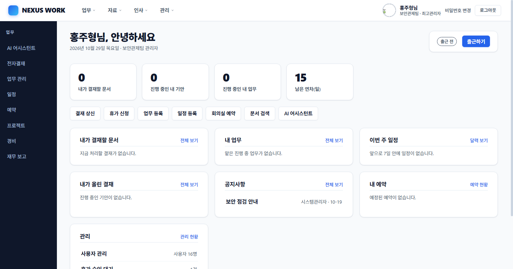
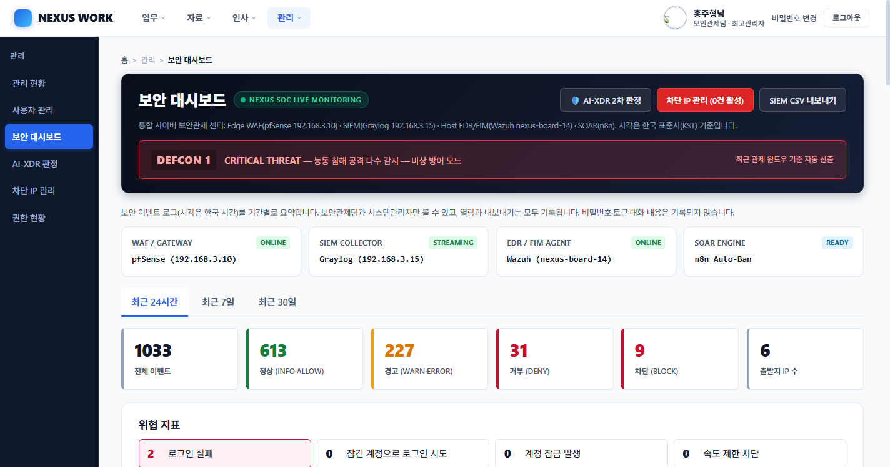
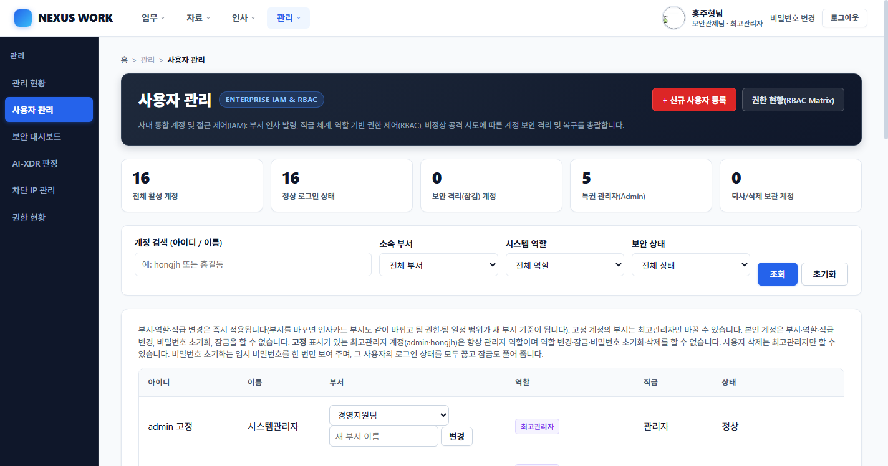
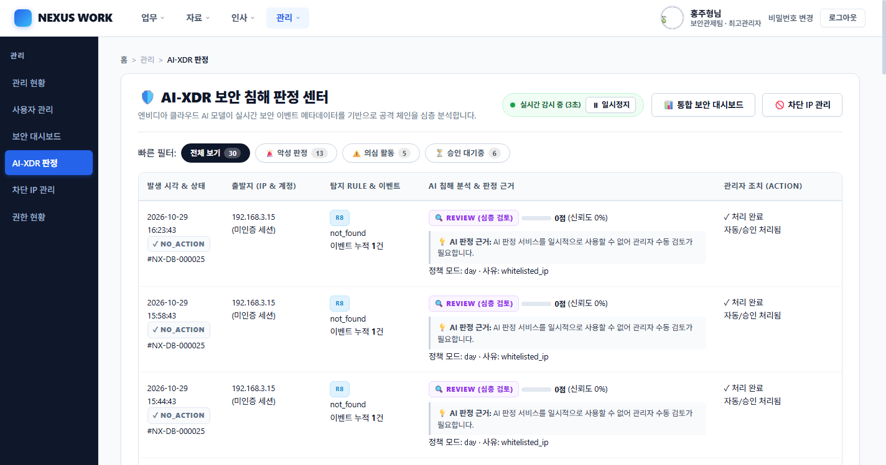
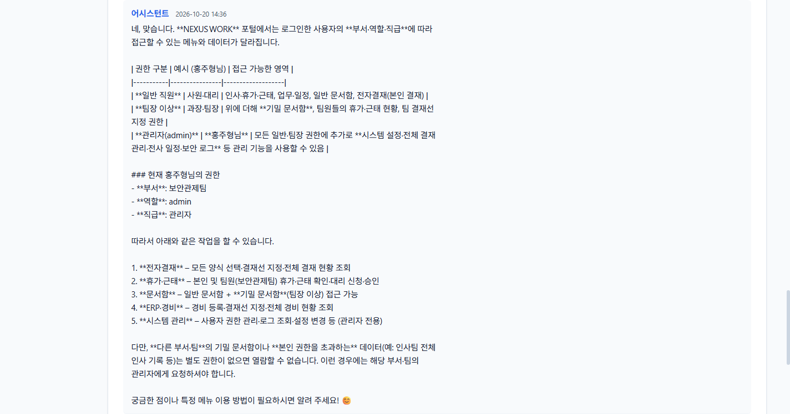
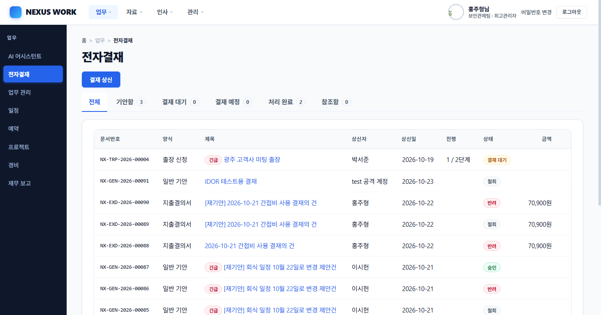
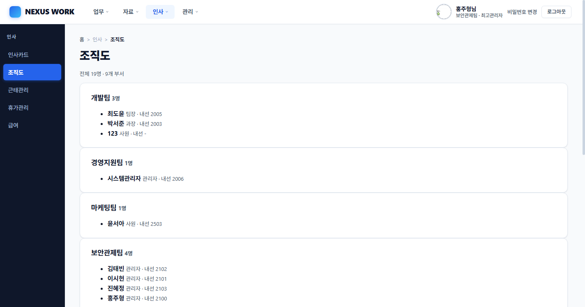
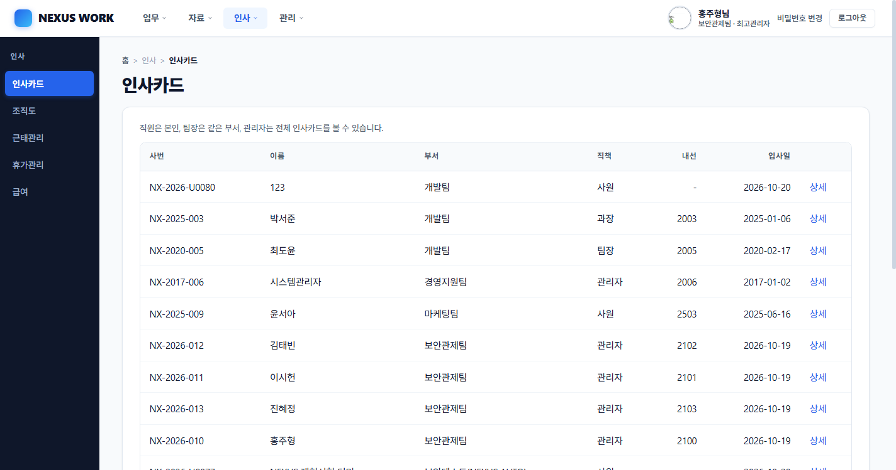

---

## 6. NEXUS Messenger (Flutter 네이티브 데스크톱 앱)

- **포털 동일 계정 연동:** SHA-256 해시 토큰 인증(30일 만료, 로그아웃 시 즉시 폐기), 포털 계정 잠금 정책 공유.
- **실시간 소통:** Flask-SocketIO 기반 1:1 및 그룹 채팅, 파일 전송, 윈도우 창 흔들기 알림.
- **조직도 연동:** 부서별 재직 사원 디렉토리 실시간 조회 및 원클릭 대화방 생성.

---

## 7. 주요 트러블슈팅 사례

1. **`/ai-xdr/process`의 `processed=0` 침묵 실패 문제:** 외부 티켓 ID 참조로 인한 외래키 위반 시 `INSERT IGNORE`로 인해 에러 없이 무시되던 현상 규명. 유효 티켓 검증 추가 및 단계별 상세 진단 로그(`xdr_process_debug`) 구축으로 해결.
2. **관리자 화면 수동 IP 차단 시 500 내부 에러:** `log_event()` 파라미터 중복 전달 및 모듈 임포트 결함 핫픽스 적용.
3. **Waitress 워커 스레드 고갈 DoS 문제 (2026-10-29):** SSE 스트림의 장시간 스레드 점유 문제를 3중 제어(`MAX_CONCURRENT=3`, `OPEN_LIMIT=10/min`, `MAX_SECONDS=600s`)로 완전 해소.

---

## 8. 팀 협업 및 역할

- **홍주형 (본인):** 포털 웹/DB 하드닝 총괄, 6대 IAM 및 비즈니스 결재 엔진 개발, 전주기 보안 AI 파이프라인 수신단 구축, 취약점 패치
- **김태빈:** 중앙 관제 서버(192.168.3.15) 구축, Wazuh/Graylog/n8n R1~R12 탐지 룰 엔진 및 자동화 워크플로 구현
- **이시헌:** 경계망(192.168.3.10) pfSense 방화벽 & HAProxy WAF 규칙 설정, 트래픽 통제
- **진혜정:** 가상화 인프라 환경 구성 및 시스템 관리

---
*※ 본 포트폴리오의 모든 데이터는 교육 및 검증용 가상 시나리오 데이터입니다.*
